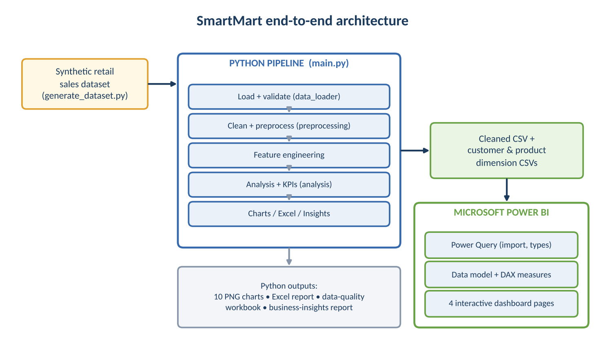
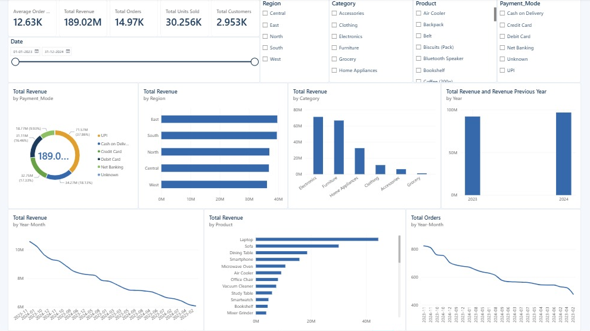
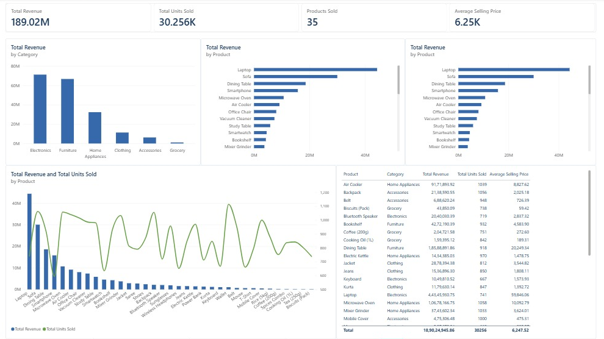
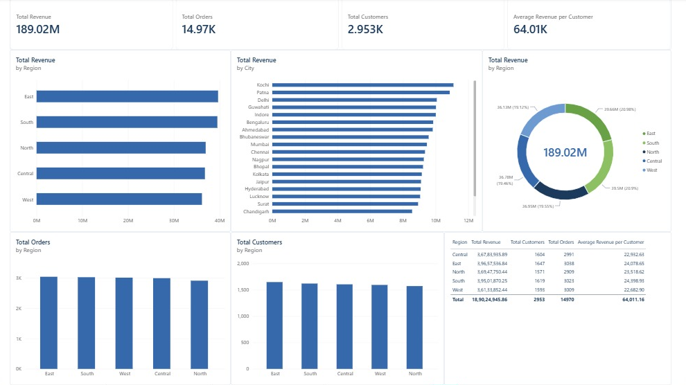
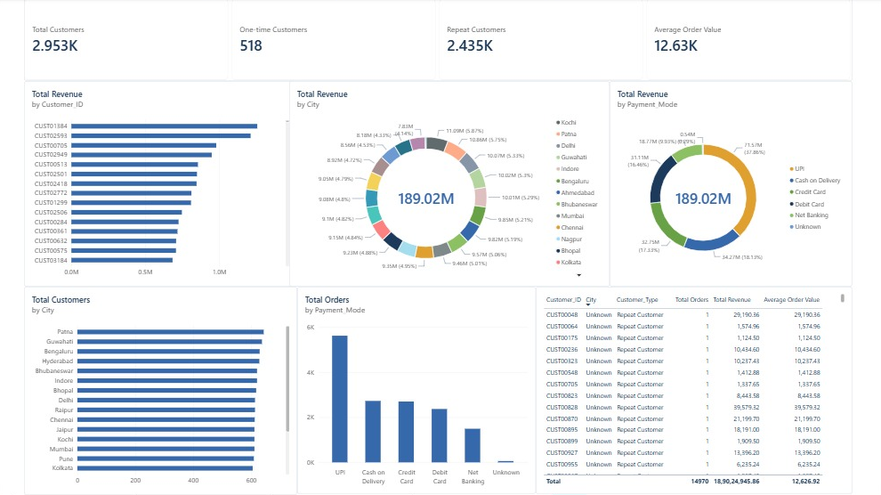

# SmartMart Sales Performance Analytics

**A Python + Microsoft Power BI retail analytics project** built for the *Python with Data Analytics* course at **Cronus Consultants** (Mentor: **Subhashish Banerjee**).

> **Synthetic data notice.** All data is generated by this project's own code. Results illustrate the method and are **not** real business results.
>
> **Power BI status.** The four-page report is included as [`powerbi/SmartMart_Sales_Dashboard_Final.pbix`](powerbi/SmartMart_Sales_Dashboard_Final.pbix) with four real screenshots in [`powerbi/screenshots/`](powerbi/screenshots). Every number legible in the screenshots matches the Python results. The dashboard implements only part of the original specification (for example no Top N filters, no Pareto cumulative line, no customer-segmentation chart, and the monthly trend axis is sorted by value rather than by date), and the independent audit could not inspect the compressed model inside the `.pbix`. Details: report Section 21.3 in [`documentation/SmartMart_Final_Report.pdf`](documentation/SmartMart_Final_Report.pdf).

---

<p align="center">
  <a href="https://smartmart.streamlit.app/">
    
  </a>
</p>

---

## Contents
[Overview](#overview) · [Business problem](#business-problem) · [Objectives](#objectives) · [Features](#key-features) · [Technology](#technology-stack) · [Architecture](#architecture) · [Structure](#project-structure) · [Dataset](#dataset) · [Install](#installation) · [Run](#running-the-python-pipeline) · [Tests](#testing) · [Power BI](#power-bi-setup) · [Screenshots](#dashboard-screenshots) · [Docs](#documentation) · [Results](#results-and-key-findings) · [Limitations](#limitations) · [Future scope](#future-scope) · [Team](#team)

## Overview
SmartMart is a fictional e-commerce retailer selling electronics, furniture, clothing, grocery, home appliances and accessories across five regions of India. The project generates a reproducible synthetic sales dataset, cleans and analyses it with Python, produces charts, Excel reports and written insights, and exposes the same data to Microsoft Power BI through a star-schema model, DAX measures and four dashboard pages.

## Business problem
Management has transaction-level data but no consolidated view of revenue, product and regional performance, customer loyalty, payment preferences or revenue concentration, and the raw data contains missing values, duplicates and invalid entries.

## Objectives
- Generate a realistic synthetic dataset with controlled data-quality issues
- Load, validate and clean the data in a tested pipeline
- Calculate revenue, orders, customers, AOV, product/category/regional/payment metrics, monthly and year-over-year trends, customer segmentation, Pareto and ABC analysis
- Produce Matplotlib/Seaborn charts, an executive dashboard image, Excel reports and a business-insights report
- Integrate Power BI (Power Query, model, DAX, a four-page report with synchronised slicers)
- Verify with automated tests and a Python-vs-DAX reconciliation

## Key features
- Modular Python application (`src/`), configuration separated in `config.py`, logging, custom exceptions and graceful error handling
- Reproducible: fixed seed; a clean-state rerun regenerates byte-identical datasets
- 10 PNG charts, 10-sheet Excel analysis workbook, data-quality workbook, 15 generated findings and 5 recommendations
- Power BI layer: 3 Power Query queries, DAX calendar, a 46-measure DAX catalogue (11 are used by the delivered `.pbix`), theme, specification, 16-section build guide, and the delivered four-page `.pbix`
- 35 pipeline and Power BI-asset tests plus 17 frontend data-layer tests; static validator and reconciliation scripts for the Power BI assets
- 45-page final report (DOCX + PDF) with code excerpts, real results, the real Power BI screenshots and a chapter on the Streamlit platform with the team's real app screenshots

## Technology stack
Python 3 · pandas · NumPy · Matplotlib · Seaborn · openpyxl · pytest · Streamlit + Plotly (web frontend) · Microsoft Power BI Desktop (Power Query M, DAX). No machine learning is used.

## Architecture
```
Synthetic dataset -> Python pipeline (load/validate -> clean -> features -> analysis)
   -> cleaned_sales_data.csv + customer_segments.csv + product_classification.csv
   -> Power BI: Power Query -> star-schema model + DAX -> 4 report pages
Python also writes: charts, Excel report, data-quality report, business insights
```


## Project structure
```
SmartMart_Sales_Analytics_Final/
├── README.md
├── main.py                 pipeline orchestration (9 steps)
├── config.py               paths, seed, sizes, thresholds
├── streamlit_app.py        NEW dynamic analytics platform (7 pages, 4 data buttons)
├── streamlit_app_classic.py  original 6-page SmartMart Streamlit dashboard (unchanged)
├── .streamlit/config.toml  light theme for the frontend
├── requirements.txt        pandas, numpy, matplotlib, seaborn, openpyxl, xlrd, pytest, streamlit, plotly
├── requirements-docs.txt   python-docx, Pillow (only to rebuild the documentation)
├── data/raw/               generated raw CSV
├── data/processed/         cleaned CSV + customer_segments.csv + product_classification.csv
├── src/                    data_loader, preprocessing, analysis, visualization, excel_report,
│                           data_quality, insights, generate_dataset, powerbi_export, dashboard_logic, utils
│                           + dynamic platform modules (see Streamlit analytics platform)
├── tests/                  6 test modules (35 pipeline/Power BI-asset tests + 17 frontend data-layer tests)
├── outputs/                charts/ (10 PNG), reports/ (Excel + insights), results/ (test + validation summaries), logs/
│                           (these are the pipeline's generated reports; `python main.py` rewrites them)
├── documentation/          SmartMart_Final_Report.docx / .pdf
├── powerbi/
│   ├── SmartMart_Sales_Dashboard_Final.pbix   the delivered Power BI report
│   ├── screenshots/        01_Executive_Overview.png ... 04_Customer_Payment.png
│   ├── BUILD_GUIDE.md      original build recipe and expected values
│   └── power_query/, dax/, data_model/, dashboard_design/, verification/ (incl. inspect_pbix.py)
└── docs/                   report build scripts, diagrams, screenshots, Testing_Report.md
```

## Dataset
Synthetic; **15,075** raw rows → **14,970** after cleaning (75 duplicates and 30 invalid rows removed), 2023-01-01 to 2024-12-31, 2,953 customers, 35 products in 6 categories, 5 regions, 21 city groups (including `Unknown`). CSV files only — no database. Data dictionary: documentation chapter 5.

## Installation
```bash
git clone <your-repository-url>
cd SmartMart-Sales-Analytics
python -m venv .venv
# Windows: .venv\Scripts\activate     macOS/Linux: source .venv/bin/activate
pip install -r requirements.txt
```

## Streamlit analytics platform (dynamic)
```bash
python -m pip install -r requirements.txt
python -m streamlit run streamlit_app.py
```
Windows (PowerShell): `py -m venv .venv`, `.venv\Scripts\activate`, then the two commands above. The app opens at http://localhost:8501. If `data/processed/*.csv` are missing, run `python main.py` once.

**What it is.** A multi-dataset business-intelligence app layered on the existing pipeline. On start it loads the built-in SmartMart CSVs; every KPI, chart, table, filter and report is then computed from the *active* dataset, whatever its columns.

**Four data-management buttons (top of every page)**
| Button | What it does |
|---|---|
| ＋ Add Row | Typed input form per column (numbers, dates, yes/no, category pick-lists) with validation; add several rows one by one. With no dataset it first lets you define columns and types. |
| Remove All Data | After confirmation, empties the *working* dataset (optionally keeping headers). Built-in CSVs, uploaded source copy and project files are never touched. |
| Upload CSV / Excel | Drag-and-drop `.csv`, `.xlsx`, `.xls`; shows size, rows/columns, types, missing values, duplicates, preview; replaces the working dataset only after you confirm. |
| Load Default Dashboard | After confirmation, re-reads the built-in SmartMart CSVs and restores the original dashboard, regardless of what was done before. |

**Pages:** Overview · Data Management (working data, upload, column mapping, sources) · Data Preparation (quality score, missing/duplicate/invalid/outlier reports; remove duplicates, handle missing values, change types, standardise categories, remove invalid rows/outliers, transformations; before/after, apply, undo) · Exploratory Analysis (histograms, box, scatter, correlation heatmap, categories, time series, outliers) · Business Intelligence (sales, HR, banking, inventory or generic analytics + automatic insights) · Reports & Export · Settings. Sidebar: dataset name and status, global filters (date, categories, numeric ranges, reset), collapsible.

**Design rules.** No KPI or chart value is hard-coded. A KPI whose column is not found (for example Total Customers without a customer column) is simply not shown. Column roles (revenue, date, customer, product, category, location, quantity, price, order id) are detected by name and content with a confidence score; low-confidence roles can be remapped by hand (Data Management → Column mapping).

**Exports.** Original upload, working/cleaned and filtered CSV; analytical summary (Markdown); business insights (TXT); data-quality report, generic Excel report; and, when the data has the full SmartMart schema, the project's original 10-sheet Excel report. Power BI files (`.pbix`, DAX, theme, CSV sources) are downloadable and unchanged.

**Screenshots.** The team's captures of the running app are in `docs/assets/streamlit/` (Overview, Data Management, upload dialog, Data Preparation, Exploratory Analysis, Business Intelligence) and are used in documentation chapter 23.

**Original dashboard.** The previous six-page SmartMart Streamlit app is unchanged in `streamlit_app_classic.py` (`python -m streamlit run streamlit_app_classic.py`).

**Module map (new):** `src/schema_detection.py`, `dataset_manager.py`, `data_upload.py`, `data_entry.py`, `data_cleaning.py`, `dynamic_analytics.py`, `visualizations.py`, `report_export.py`, `ui_components.py`, `ui_pages.py`. Existing `src/` modules are untouched.

**Limitations.** Session state lives in the browser session: restarting the app (or Settings → Reset session) returns to the default dataset, and manual or uploaded data is not persisted. Domain analytics (HR, banking, inventory) are keyword-based and appear only when matching columns exist. See `docs/Testing_Report.md` and report Chapter 25 for what was verified.

## Running the Python pipeline
```bash
python main.py                   # full pipeline (generates data if missing)
python main.py --generate-data   # regenerate the raw dataset only
python main.py --analyze         # load, clean and analyse only (no charts or reports)
python main.py --report          # full pipeline, regenerating all reports (same as --all)
```
Outputs: `data/processed/*.csv`, `outputs/charts/*.png`, `outputs/reports/*.xlsx|txt`, `outputs/logs/application.log`.

## Testing
```bash
pytest -q
python powerbi/verification/validate_powerbi_assets.py     # static check of DAX / M files
python powerbi/verification/reconcile_python_vs_dax.py     # Python vs DAX-equivalent reconciliation
```
Results are in [`docs/Testing_Report.md`](docs/Testing_Report.md): 35 pipeline tests passed with real pytest 9.1.1; the whole suite (incl. the Streamlit platform modules) gave 94 passed, 2 skipped (the skipped tests need Streamlit installed). The DAX/M checks are static or pandas-emulated; `python powerbi/verification/inspect_pbix.py` reads the delivered `.pbix` (read-only) and lists its pages, visuals, fields and checks.

## Power BI
**Verification.** The project team opened and tested the delivered Power BI report in Power BI Desktop. All four report pages were checked, and the report was confirmed to load and display its visuals correctly. The team also checked the dashboard functionality and slicer interactions. The audit independently validated the available DAX and Power Query source files and compared displayed results against Python outputs. Independent inspection of the internal semantic model was limited by the PBIX file's compressed structure.

**Opening the report.** Install Power BI Desktop for Windows (free) and open `powerbi/SmartMart_Sales_Dashboard_Final.pbix`. The file stores the data model, so it opens without the CSV files. If **Home > Refresh** fails (the original source folder no longer exists), use **Transform data > Data source settings** to point the sources at this project's `data/processed/` folder; the data sources stored inside the `.pbix` were not inspected by the audit.

**Pages.** Executive Overview, Product Performance, Regional Performance, Customer & Payment. Five slicers (Date, Region, Category, Product, Payment_Mode) are synchronised on all pages and visible on page 1; use them there to filter every page.

**Rebuilding or extending the report.** `powerbi/BUILD_GUIDE.md` documents the original recipe (parameter, three queries, calendar table, relationships, 46 measures, theme, page layouts) and the expected values. After a Python rerun use **Home > Refresh**.

**What the delivered dashboard contains.** Page 1: KPI cards, revenue by payment mode, region, category, year, product and two monthly line charts. Page 2: product KPI cards, category and product revenue charts, a units-and-revenue combo chart and a product table. Page 3: regional KPI cards, revenue by region and city, orders and customers by region, regional table. Page 4: customer KPIs (including one-time and repeat counts), top customers by revenue, revenue by city and payment mode, orders by payment mode, customer table.

**Not implemented (future scope).** Top 10 / Bottom 10 filters, Pareto cumulative line, ABC matrix, customer-segmentation and customer-type charts, regional trend line, highest/lowest region cards, chronological month sorting, custom titles and alt text. These analyses exist in the Python pipeline where noted in the report; the dashboard does not show them.

Files: [`power_query/`](powerbi/power_query) · [`dax/`](powerbi/dax) · [`data_model/model_documentation.md`](powerbi/data_model/model_documentation.md) · [`dashboard_design/dashboard_specification.md`](powerbi/dashboard_design/dashboard_specification.md) · [`verification/`](powerbi/verification)

## Dashboard screenshots
Captured by the team in Power BI Desktop (52% zoom) and cropped to the report canvas; no other editing.

| Page | Screenshot |
|---|---|
| Executive Overview |  |
| Product Performance |  |
| Regional Performance |  |
| Customer & Payment |  |

The same four screenshots appear in Appendix C of the report as the delivered dashboard layouts.

## Documentation
- [`documentation/SmartMart_Final_Report.pdf`](documentation/SmartMart_Final_Report.pdf) / `.docx` — final project report (45 pages, includes the Streamlit platform chapter)
- [`docs/Testing_Report.md`](docs/Testing_Report.md) — what was tested and how
- [`powerbi/verification/reconciliation_report.md`](powerbi/verification/reconciliation_report.md) — Python vs DAX-equivalent figures
- Rebuild: `pip install -r requirements-docs.txt && python docs/make_diagrams.py && python docs/build_documentation.py` (needs LibreOffice for the PDF)

## Results and key findings
All values below are calculated from the synthetic data by this project.

| Metric | Value |
|---|---:|
| Total revenue | ₹189,024,945.86 |
| Total orders / customers | 14,970 / 2,953 |
| Units sold | 30,256 |
| Average order value / selling price | ₹12,626.92 / ₹6,247.52 |
| Top category | Electronics (37.7%) |
| Top / lowest region | East (₹39,657,536.84) / West (₹36,133,852.44) |
| Peak / lowest month | November 2023 / February 2023 |
| Revenue growth 2024 vs 2023 | +5.1% |
| Repeat customers | 2,435 (82.5%) |
| Payment leader | UPI (37.5% of orders) |
| Products for ~80% of revenue | 10 of 35 |

Pareto/ABC, RFM segments, Top-N rankings and regional highlights above are **Python results**; the Power BI dashboard shows a subset (see the status table in the Power BI section).

Interpretation caveat: seasonality, payment mix, regional balance and the high repeat rate largely reflect generator settings and should not be read as real market behaviour.

## Limitations
Synthetic data only · CSV-based (no database) · descriptive analytics only (no forecasting/ML) · one product per order · RFM segments are whole-period · the delivered Power BI report covers only part of the specified analysis, and the independent audit could not inspect its compressed internal model · 60 order records have city `Unknown` · the segmentation code defines an `Occasional` label that is unreachable with current rules (documented, unchanged).

## Future scope
Complete the planned dashboard visuals (Top 10 / Bottom 10 filters, Pareto, ABC matrix, segmentation, regional trend, region highlight cards, chronological month sorting, titles and alt text) · real data source and SQL layer · forecasting · refined segmentation and customer lifetime value · multi-line orders and basket analysis · Power BI Service publishing and row-level security · CI with GitHub Actions.

## Team
**Team A**

- Ankit Biswas
- Amlan Kar
- Argha Banerjee
- Anubhab Roy
- Chandradeep Mondal
- Debanjan Naskar
- Abhishek Pal

Training organization: Cronus Consultants · Mentor: Subhashish Banerjee · Course: Python with Data Analytics
